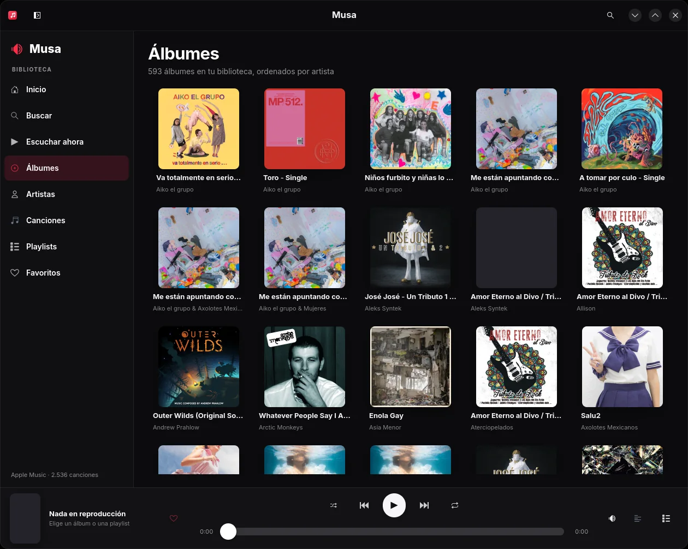
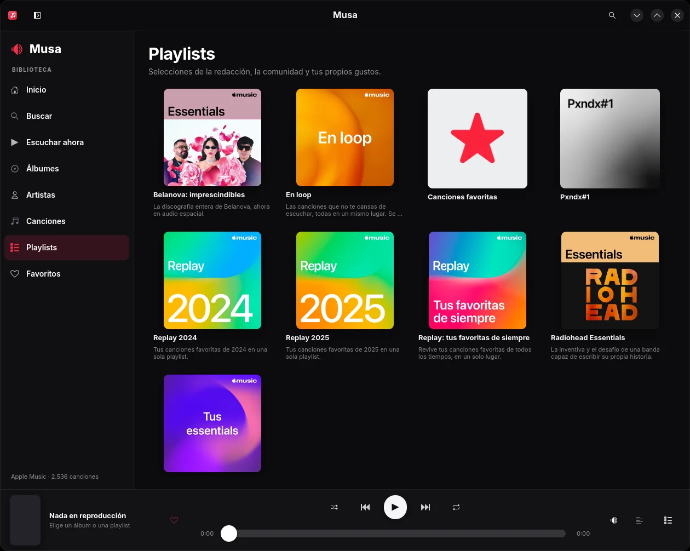
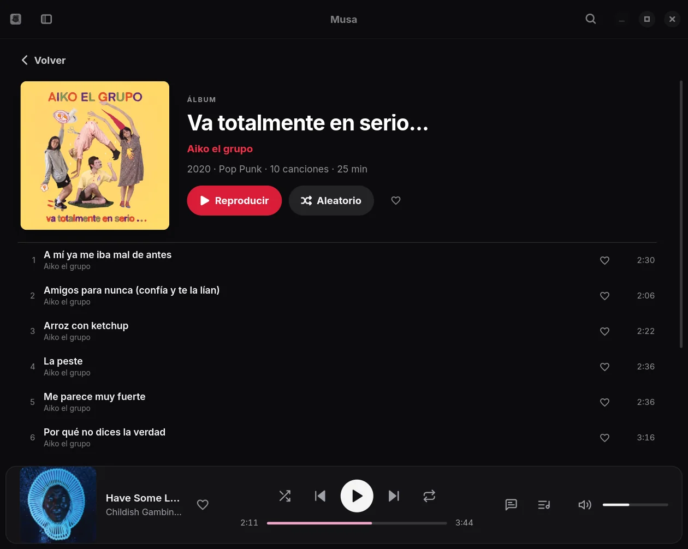
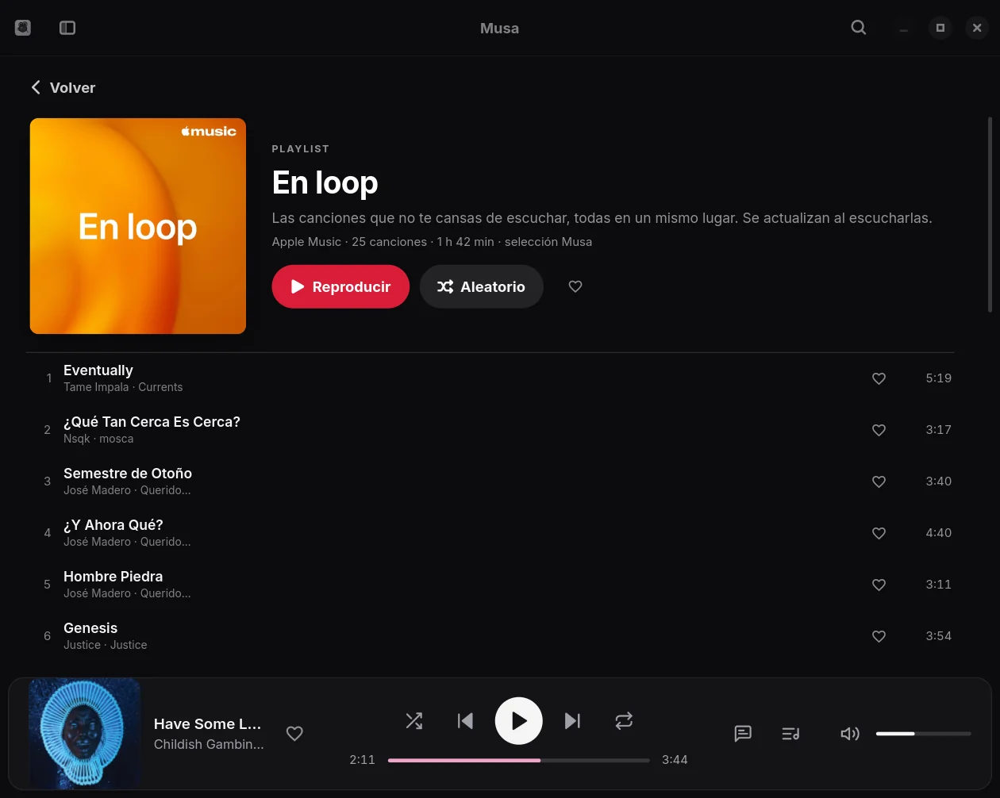
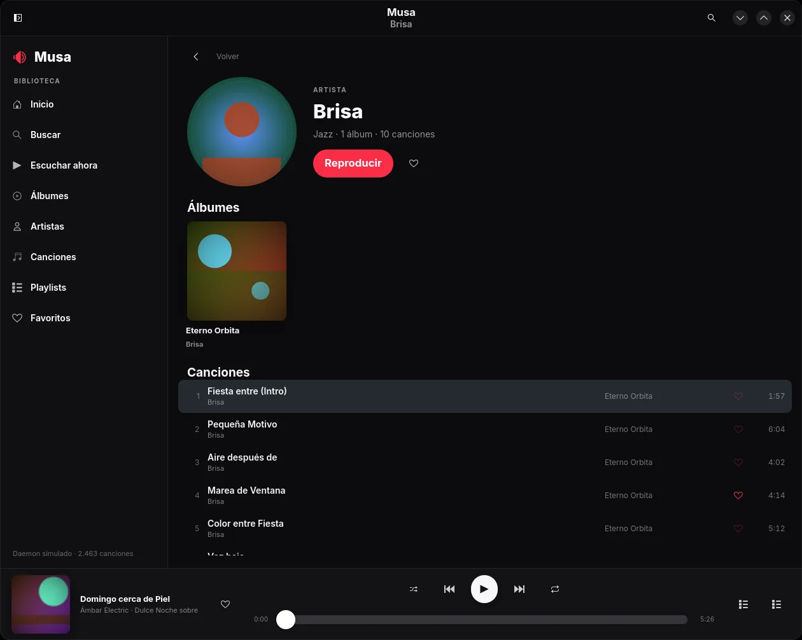

<p align="center">
  
</p>

<h1 align="center">Musa</h1>

<p align="center"><strong>Apple Music, native on Linux.</strong><br>A desktop client written in Rust with GTK4, libadwaita and relm4.</p>

<p align="center">
  <a href="#getting-started"><strong>Get started</strong></a> ·
  <a href="#screenshots">Screenshots</a> ·
  <a href="#architecture">Architecture</a> ·
  <a href="#contributing">Contributing</a>
</p>

<p align="center">
  <a href="Cargo.toml"></a>
  <a href="#install"></a>
  <a href="LICENSE"></a>
</p>

Musa is an **Apple Music client for Linux** with a native interface: the window,
the virtual lists, the artwork and the player are built in Rust with GTK4,
libadwaita and relm4. The catalog and playback come from your Apple Music
account through a local sidecar running MusicKit and Widevine.

The idea is simple: **install Musa, open it, sign in to Apple Music and your
library shows up.**

> The interface is currently in Spanish; Musa is not localized yet.

The name is also a wink: ***mus*** is mouse in Latin, hence the little grey and
black mouse in the logo.

> Independent project. Not affiliated with or endorsed by Apple. «Apple Music»
> is a trademark of Apple Inc.; interoperability is the only thing described
> here.

**You need an Apple Music subscription to play music.** Sign-in and the library
are handled in Apple's own window; Musa never asks for or stores your password.


[Features](#features) · [Install](#install) · [First session](#first-session) · [Architecture](#architecture) · [Screenshots](#screenshots)

## Features

| Feature | What you can do |
|---|---|
| **Your library** | Songs, albums, artists and playlists from your Apple Music account, with virtual lists and local search by title, artist, album or genre. |
| **Catalog search** | Beyond your library, search songs, albums and artists across all of Apple Music; open their pages and play them even if you don't own them. |
| **Followed artists** | Add artists you don't have yet: they show up in **Artists** and **Home**, and their page is filled in with the catalog's albums and popular songs. Saving is local; syncing with Apple Music is best-effort. |
| **Albums to your library** | Add a whole catalog album with its songs. It is saved in Musa instantly and an attempt is made to mirror it in your Apple Music library. |
| **Home and Listen Now** | Personal mix, new releases from your library and an editorial hub with mixes, favorites, playlists and artists. |
| **Persistent player** | Artwork, title and artist, previous, play/pause, next, shuffle, repeat, progress, times and volume. It never goes away. |
| **Queue and lyrics** | View the queue and jump around in it; open Apple's lyrics in their own window with the current line highlighted and scrolled to the center. |
| **Favorites** | Mark songs, albums, artists and playlists with a grey outline heart or a filled red one, with a toast and **Undo**. For now they are stored locally. |
| **Details** | Large artwork, actions and track list. The artwork and header scroll with the list in a single scroll; «Back» stays pinned. |
| **Artwork** | The sidecar downloads your library's artwork and Musa decodes it at the real size × `scale_factor`, with a 16 MB LRU cache and four workers. |
| **Desktop** | Fuzzel launcher, its own icon, and shutdown that pauses playback and turns the engine off. |

<a id="architecture"></a>

## How it works

The interface does not keep a copy of the library: the `musad` daemon is the
single source of truth. The UI keeps only what it needs to draw plus a cache of
decoded pixels. The daemon talks to the Electron sidecar, the only process that
opens MusicKit and Widevine and plays audio through PipeWire.

```
┌────────────────────────┐  newline-delimited JSON  ┌────────────────────────┐
│  musa (GTK4/relm4)     │◄────────────────────────►│  musad                 │
│  UI, virtual lists     │  Unix socket, mode 0600  │  library, queue,       │
│  LRU artwork cache     │                          │  favorites, lyrics     │
└────────────────────────┘                          └───────────┬────────────┘
                                                                │ JSON over stdio
                                                    ┌───────────▼────────────┐
                                                    │ Electron sidecar       │
                                                    │ MusicKit + Widevine    │
                                                    │ audio to PipeWire      │
                                                    └────────────────────────┘
```

- **No library cache in the UI**: the daemon holds the models and the sidecar
  caches the last Apple library so startup is fast.
- **On close**: Musa pauses playback and shuts down the daemon/sidecar. No music
  is left playing in the background.
- **Local favorites**: the heart updates the local copy; syncing with Apple
  Music is still pending.
- **Local followed artists**: stored in `artists.json` and merged with your
  library at startup. Adding an artist does not download their discography;
  their page and songs are read from the catalog. Syncing with Apple is
  best-effort and removing one only affects Musa.
- **Locally added albums**: stored in `albums.json` with their songs and merged
  with your library at startup, so they stay there even if Apple's cache takes
  a while to include them.
- The protocol between the UI and the daemon is newline-delimited JSON over a
  Unix socket.

## Install

Requirements: Rust 1.85+ (2024 edition), GTK4 ≥ 4.14, libadwaita ≥ 1.5, a C
compiler, `pkg-config`, an Apple Music account and castLabs' Electron with
Widevine for the sidecar.

On Fedora:

```bash
sudo dnf install gtk4-devel libadwaita-devel rust cargo
make build
cd sidecar && npm install
```

If only the libadwaita runtime is installed, the script downloads the
development RPM **without sudo** and extracts it into `.deps/`:

```bash
./scripts/setup-libadwaita.sh
make build
```

| You want to… | Do this |
|---|---|
| **Build** | `make build` |
| **Install the sidecar** | `cd sidecar && npm install` (downloads the Electron build with Widevine; it is the only heavy bit). |
| **Use another castLabs Electron** | `export MUSA_ELECTRON=/path/to/electron` |
| **Install the launcher** | `./scripts/install-launcher.sh`; puts Musa in Fuzzel and updates the mouse icon. |
| **Open it** | `./target/release/musa` |
| **See the daemon logs** | `./scripts/run.sh` |

After building there are two binaries:

```
target/release/musad   # daemon: library, search, favorites, queue
target/release/musa    # GTK4 interface
```

<a id="getting-started"></a>
<a id="first-session"></a>

## First session

1. Run `./target/release/musa`. The first time, the sidecar's
   **music.apple.com** window opens so you can sign in with your Apple ID.
   If it doesn't open, run `./scripts/sidecar-login.sh`.
2. Complete sign-in and two-factor verification in that window. The session
   lands in `~/.config/musa/sidecar/` with user-only permissions. Don't share
   your password or the session files.
3. As soon as Apple authorizes the account, Musa hides the login window,
   downloads your library (the first time; later runs use the cache) and shows
   the main window.
4. From then on, open Musa and your library is there. Playing music needs an
   active Apple Music subscription.

If the sidecar can't find Electron, check `MUSA_ELECTRON` or run
`cd sidecar && npm install`. Startup errors are logged in
`~/.cache/musa/musad.log` and `~/.cache/musa/sidecar.log`.

Useful variables:

| Variable | Effect |
|---|---|
| `MUSA_SOCKET` | Unix socket path. |
| `MUSA_DAEMON` | Path to `musad` if it isn't next to `musa`. |
| `MUSA_NO_AUTOSTART=1` | Don't start the daemon automatically. |
| `MUSA_ELECTRON` | Path to the sidecar's castLabs/Widevine Electron. |
| `MUSA_SIDECAR_JS` | Alternative path to `sidecar/main.js`. |
| `MUSA_MEASURE_SECONDS` | Shortens measurements for development testing. |
| `GSK_RENDERER` | `cairo`, `ngl` or `vulkan` to compare the render floor. |

On-disk paths (nothing is ever written outside them):

- `~/.cache/musa/` — `real-library.json`, `covers/`, `player.json`,
  `musad.log` and `sidecar.log`.
- `~/.config/musa/` — `favorites.json`, `artists.json`, `albums.json` and
  `sidecar/` with the Apple session.
- Default socket: `~/.cache/musa/musad.sock` (mode `0600`).

## Screenshots

| Albums | Artists | Songs |
| --- | --- | --- |
|  |  |  |

| Playlists | Favorites | Search |
| --- | --- | --- |
|  |  |  |

| Album detail | Playlist detail | Artist detail |
| --- | --- | --- |
|  |  |  |

## Status

Musa is a **working MVP**: Apple Music sign-in, the library, search and real
playback all work. What is missing is mostly syncing and desktop controls.

| Area | Status |
|---|---|
| Apple Music sign-in | **Verified** |
| Library, search and details | **Works** |
| Playback with MusicKit/Widevine | **MVP** |
| Favorites | **Local** (no Apple sync) |
| Followed artists | **Local** (best-effort Apple sync) |
| Added albums | **Local** (best-effort Apple sync) |
| Lyrics | **Depends on web token permissions** |
| MPRIS and media controls | **Pending** |
| Queue restore across sessions | **In design** |

## Contributing

Before opening a change, make sure everything is still green:

```bash
make test          # protocol and daemon unit tests
make fmt
make clippy        # -D warnings
(cd sidecar && npm test)
```

Actually testing the interface requires an Apple Music session and the sidecar.
Never commit passwords, tokens or session files.

## Roadmap

- **MPRIS**: desktop media controls.
- **Synced favorites** with Apple Music.
- **Queue restore** and shutting the engine down when idle.
- **CLI client**: the engine is already independent of GTK; a terminal client
  can play music and query the queue and lyrics over the same socket.

## Acknowledgements

Musa uses [Rust](https://www.rust-lang.org), [GTK4](https://www.gtk.org),
[libadwaita](https://gnome.pages.gitlab.gnome.org/libadwaita/),
[relm4](https://relm4.org), [Electron](https://www.electronjs.org), MusicKit and
Widevine for the real integration, and the [Inter](https://rsms.me/inter/) typeface.

Musa is an independent project and is not affiliated with Apple. «Apple Music»
is a trademark of Apple Inc.

Licensed under the [MIT License](LICENSE).
