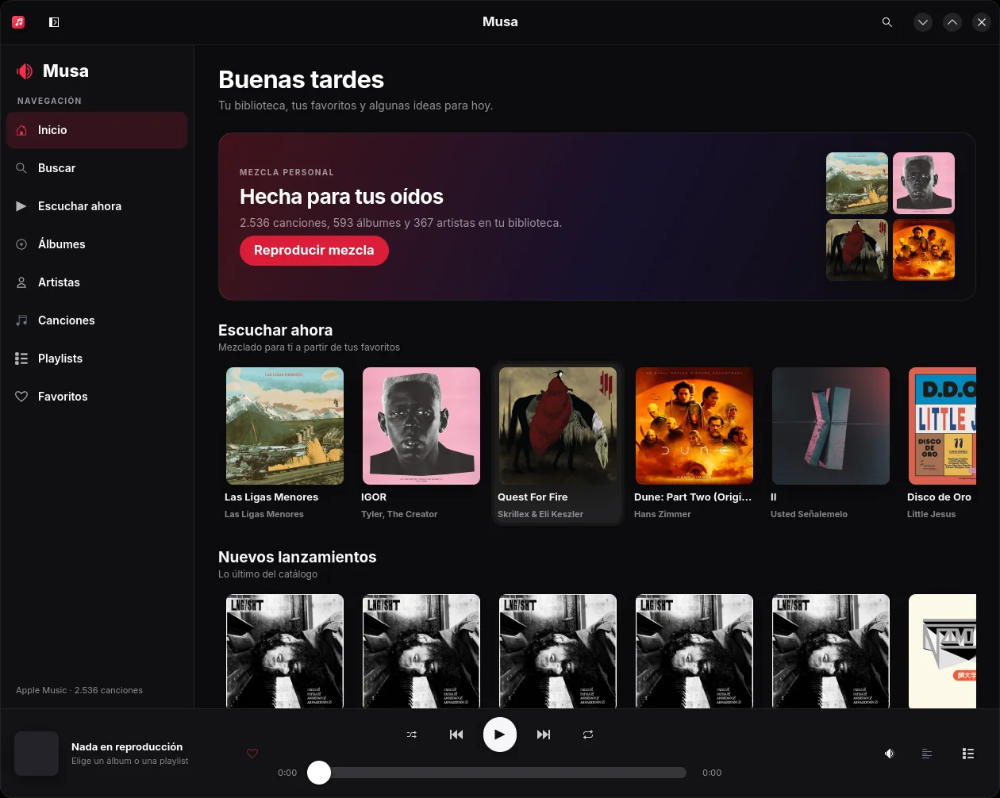
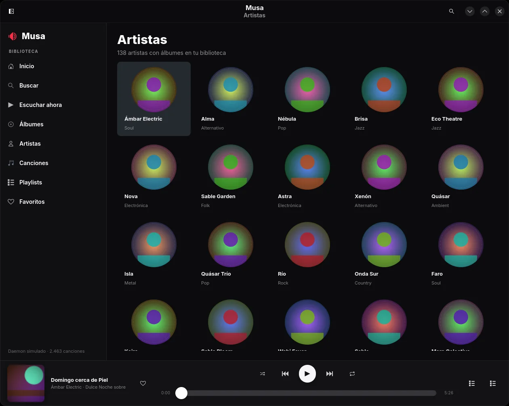
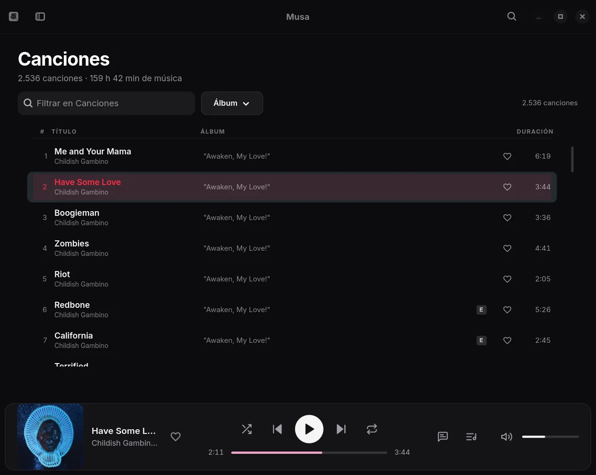
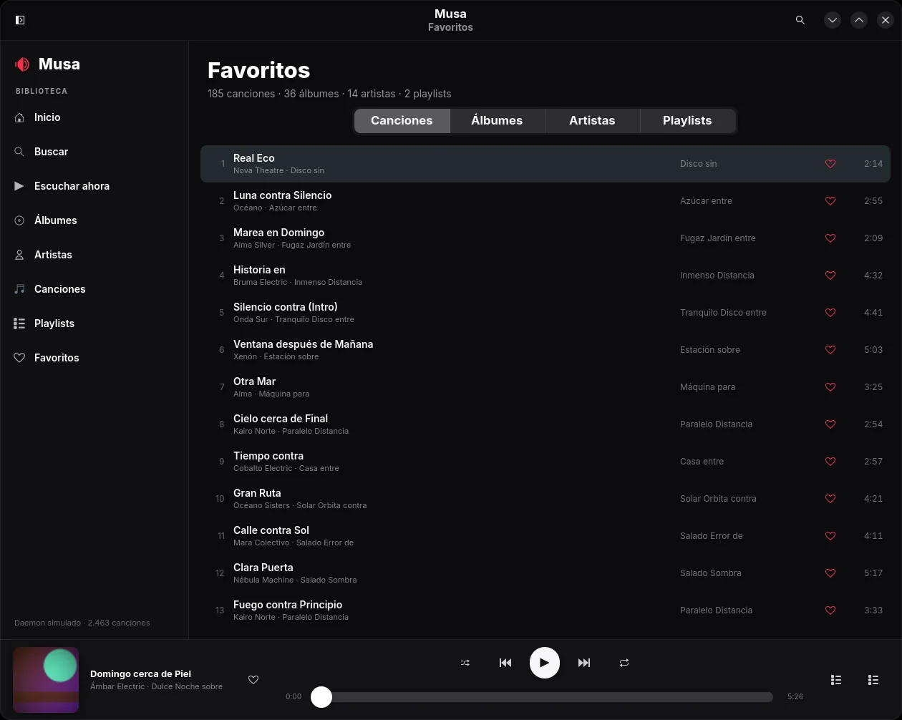
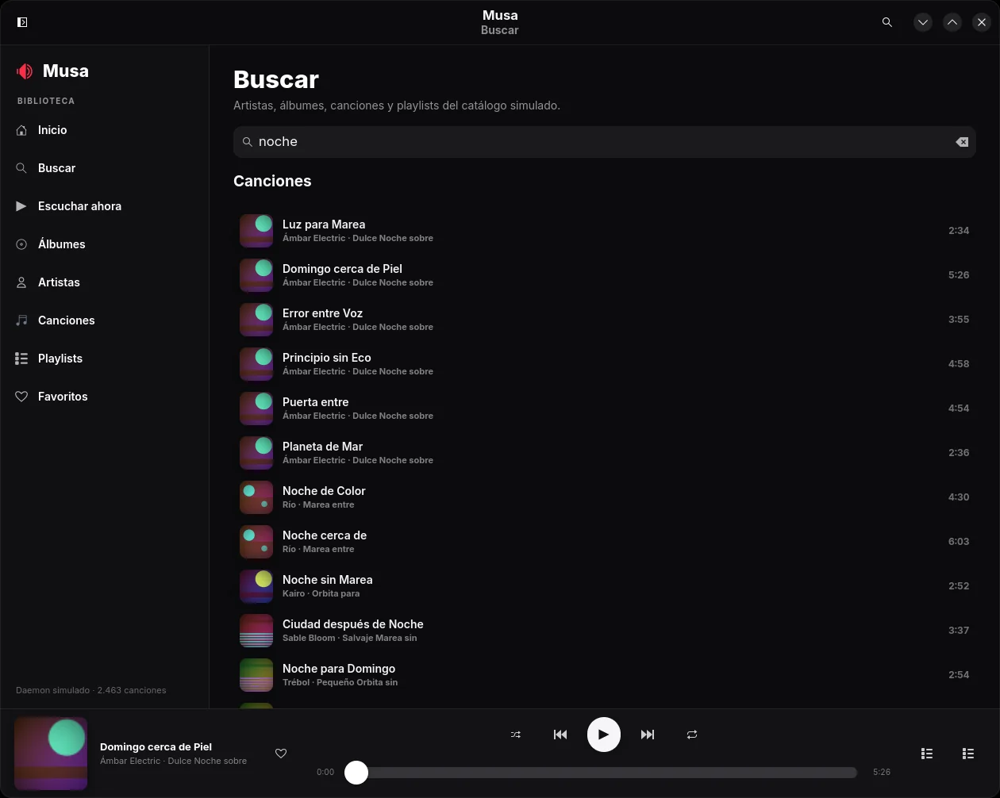

<p align="center">
  
</p>

<h1 align="center">Musa</h1>

<p align="center"><strong>Apple Music, nativo en Linux.</strong><br>Un cliente de escritorio escrito en Rust con GTK4, libadwaita y relm4.</p>

<p align="center">
  <a href="#empezar"><strong>Empezar</strong></a> ·
  <a href="#capturas">Capturas</a> ·
  <a href="#arquitectura">Arquitectura</a> ·
  <a href="#contribuir">Contribuir</a>
</p>

<p align="center">
  <a href="Cargo.toml"></a>
  <a href="#instalar"></a>
  <a href="LICENSE"></a>
</p>

Musa es un cliente de **Apple Music para Linux** con una interfaz nativa: la
ventana, las listas virtuales, las portadas y el reproductor están hechos en
Rust con GTK4, libadwaita y relm4. El catálogo y la reproducción vienen de tu
cuenta de Apple Music a través de un sidecar local con MusicKit y Widevine.

La idea es simple: **instalas Musa, lo abres, inicias sesión en Apple Music y
tu biblioteca aparece.**

El nombre también es un guiño: ***mus*** es ratón en latín, y de ahí el ratoncito
gris y negro de la marca.

> Proyecto independiente. No está afiliado ni patrocinado por Apple. «Apple
> Music» es una marca de Apple Inc.; aquí solo se describe interoperabilidad.

**Necesitas una suscripción de Apple Music para reproducir.** El inicio de
sesión y la biblioteca se gestionan en la ventana de Apple; Musa nunca pide ni
guarda tu contraseña.



[Funciones](#funciones) · [Instalar](#instalar) · [Primera sesión](#primera-sesion) · [Arquitectura](#arquitectura) · [Capturas](#capturas)

## Funciones

| Función | Qué puedes hacer |
|---|---|
| **Tu biblioteca** | Canciones, álbumes, artistas y playlists de tu cuenta de Apple Music, con listas virtuales y búsqueda local por título, artista, álbum o género. |
| **Búsqueda en el catálogo** | Además de tu biblioteca, busca canciones, álbumes y artistas en todo Apple Music; puedes abrir sus fichas y reproducirlos aunque no los tengas. |
| **Inicio y Escuchar ahora** | Mezcla personal, novedades de tu biblioteca y un hub editorial con mezclas, favoritas, playlists y artistas. |
| **Reproductor persistente** | Portada, título y artista, anterior, reproducir/pausar, siguiente, aleatorio, repetición, progreso, tiempos y volumen. Nunca desaparece. |
| **Cola y letras** | Ver y saltar dentro de la cola; abrir las letras de Apple en una ventana propia con la línea actual resaltada y desplazada al centro. |
| **Favoritos** | Marcar canciones, álbumes, artistas y playlists con un corazón de contorno gris o relleno rojo, con toast y **Deshacer**. Hoy se guardan en local. |
| **Detalles** | Portada grande, acciones y lista de pistas. La portada y la cabecera se desplazan con la lista en un único scroll; «Volver» queda fijo. |
| **Portadas** | El sidecar descarga las portadas de tu biblioteca y Musa las decodifica al tamaño real × `scale_factor`, con caché LRU de 16 MB y cuatro workers. |
| **Escritorio** | Lanzador para Fuzzel, icono propio y cierre que pausa la reproducción y apaga el motor. |

<a id="arquitectura"></a>

## Cómo funciona

La interfaz no guarda una copia de la biblioteca: el daemon `musad` es la única
fuente de verdad. La UI conserva solo lo necesario para pintar y una caché de
píxeles decodificados. El daemon habla con el sidecar Electron, el único proceso
que abre MusicKit y Widevine y reproduce audio en PipeWire.

```
┌────────────────────────┐   JSON por líneas   ┌────────────────────────┐
│  musa (GTK4/relm4)     │◄───────────────────►│  musad                 │
│  UI, listas virtuales  │  socket Unix 0600   │  biblioteca, cola,     │
│  caché LRU de portadas │                     │  favoritos, letras     │
└────────────────────────┘                     └───────────┬────────────┘
                                                           │ stdio JSON
                                               ┌───────────▼────────────┐
                                               │ sidecar Electron       │
                                               │ MusicKit + Widevine    │
                                               │ audio a PipeWire       │
                                               └────────────────────────┘
```

- **Sin caché de biblioteca en la UI**: el daemon conserva los modelos y el
  sidecar cachea la última biblioteca de Apple para arrancar rápido.
- **Al cerrar**: Musa pausa la reproducción y apaga el daemon/sidecar. No queda
  música sonando en segundo plano.
- **Favoritos locales**: el corazón actualiza la copia local; la sincronización
  con Apple Music queda pendiente.
- El protocolo entre la UI y el daemon es JSON por líneas sobre un socket Unix.

## Instalar

Requisitos: Rust 1.85+ (edición 2024), GTK4 ≥ 4.14, libadwaita ≥ 1.5, un
compilador de C, `pkg-config`, una cuenta de Apple Music y el Electron de
castLabs con Widevine para el sidecar.

En Fedora:

```bash
sudo dnf install gtk4-devel libadwaita-devel rust cargo
make build
cd sidecar && npm install
```

Si solo está el runtime de libadwaita, el script descarga **sin sudo** el RPM de
desarrollo y lo extrae en `.deps/`:

```bash
./scripts/setup-libadwaita.sh
make build
```

| Quieres… | Haz esto |
|---|---|
| **Compilar** | `make build` |
| **Instalar el sidecar** | `cd sidecar && npm install` (descarga el Electron con Widevine; es lo único pesado). |
| **Usar otro Electron castLabs** | `export MUSA_ELECTRON=/ruta/al/electron` |
| **Instalar el lanzador** | `./scripts/install-launcher.sh`; deja Musa en Fuzzel y actualiza el icono del ratoncito. |
| **Abrir** | `./target/release/musa` |
| **Ver los logs del daemon** | `./scripts/run.sh` |

Tras compilar hay dos binarios:

```
target/release/musad   # daemon: biblioteca, búsqueda, favoritos, cola
target/release/musa    # interfaz GTK4
```

<a id="empezar"></a>
<a id="primera-sesion"></a>

## Primera sesión

1. Ejecuta `./target/release/musa`. La primera vez se abre la ventana de
   **music.apple.com** del sidecar para que inicies sesión con tu Apple ID.
   Si no se abre, ejecuta `./scripts/sidecar-login.sh`.
2. Completa el inicio de sesión y la verificación en dos pasos en esa ventana.
   La sesión queda en `~/.config/musa/sidecar/` con permisos de usuario. No
   compartas tu contraseña ni los archivos de sesión.
3. En cuanto Apple autoriza la cuenta, Musa oculta la ventana de login, descarga
   tu biblioteca (la primera vez; las siguientes usan la caché) y muestra la
   ventana principal.
4. A partir de ahí, abre Musa y tu biblioteca estará ahí. Para reproducir hace
   falta una suscripción activa de Apple Music.

Si el sidecar no encuentra Electron, revisa `MUSA_ELECTRON` o ejecuta
`cd sidecar && npm install`. Los errores del arranque quedan en
`~/.cache/musa/musad.log` y `~/.cache/musa/sidecar.log`.

Variables útiles:

| Variable | Efecto |
|---|---|
| `MUSA_SOCKET` | Ruta del socket Unix. |
| `MUSA_DAEMON` | Ruta a `musad` si no está junto a `musa`. |
| `MUSA_NO_AUTOSTART=1` | No arrancar el daemon automáticamente. |
| `MUSA_ELECTRON` | Ruta al Electron castLabs/Widevine del sidecar. |
| `MUSA_SIDECAR_JS` | Ruta alternativa a `sidecar/main.js`. |
| `MUSA_MEASURE_SECONDS` | Acorta las mediciones para pruebas de desarrollo. |
| `GSK_RENDERER` | `cairo`, `ngl` o `vulkan` para comparar el piso de render. |

Rutas en disco (nunca se escribe fuera de ellas):

- `~/.cache/musa/` — `real-library.json`, `covers/`, `player.json`,
  `musad.log` y `sidecar.log`.
- `~/.config/musa/` — `favorites.json` y `sidecar/` con la sesión de Apple.
- Socket por defecto: `~/.cache/musa/musad.sock` (modo `0600`).

## Capturas

| Álbumes | Artistas | Canciones |
| --- | --- | --- |
|  |  |  |

| Playlists | Favoritos | Búsqueda |
| --- | --- | --- |
|  |  |  |

| Detalle de álbum | Detalle de playlist | Detalle de artista |
| --- | --- | --- |
|  |  |  |

## Estado

Musa está en **MVP funcional**: el login de Apple Music, la biblioteca, la
búsqueda y la reproducción real funcionan. Lo que falta es sobre todo
sincronización y controles del escritorio.

| Área | Estado |
|---|---|
| Inicio de sesión en Apple Music | **Verificado** |
| Biblioteca, búsqueda y detalles | **Funciona** |
| Reproducción con MusicKit/Widevine | **MVP** |
| Favoritos | **Locales** (sin sincronización con Apple) |
| Letras | **Según permisos del token web** |
| MPRIS y controles multimedia | **Pendiente** |
| Restauración de cola entre sesiones | **En diseño** |

## Contribuir

Antes de abrir un cambio, comprueba que todo sigue en verde:

```bash
make test          # unitarias del protocolo y del daemon
make fmt
make clippy        # -D warnings
(cd sidecar && npm test)
```

Probar la interfaz de verdad requiere una sesión de Apple Music y el sidecar.
No incluyas contraseñas, tokens ni archivos de sesión en el repositorio.

## Lo que viene

- **MPRIS**: controles multimedia del escritorio.
- **Favoritos sincronizados** con Apple Music.
- **Restauración de cola** y apagado por inactividad del motor.
- **Cliente CLI**: el motor ya es independiente de GTK; un cliente de terminal
  puede reproducir y consultar cola y letras por el mismo socket.

## Agradecimientos

Musa usa [Rust](https://www.rust-lang.org), [GTK4](https://www.gtk.org),
[libadwaita](https://gnome.pages.gitlab.gnome.org/libadwaita/),
[relm4](https://relm4.org), [Electron](https://www.electronjs.org), MusicKit y
Widevine para la integración real, y la tipografía [Inter](https://rsms.me/inter/).

Musa es un proyecto independiente y no está afiliado a Apple. «Apple Music» es
una marca de Apple Inc.

Licenciado bajo la [Licencia MIT](LICENSE).
